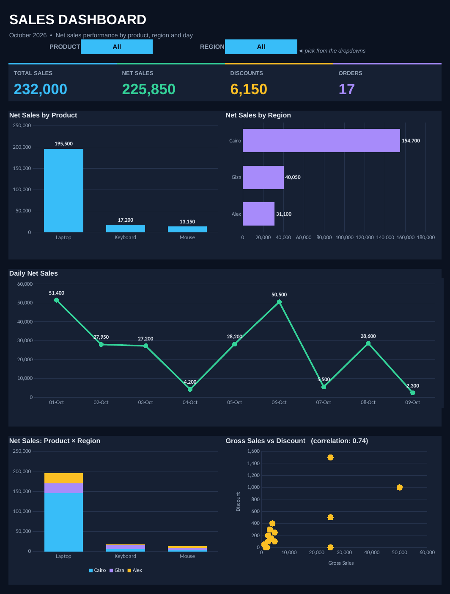

# Sales Dashboard

An Excel sales dashboard built on a small October 2026 orders dataset (17 orders, 3 products, 3 regions). It tracks total sales, net sales, discounts and order count, and shows how sales break down by product, region and day.



## Key results

| Metric | Value |
|---|---|
| Total (gross) sales | 232,000 |
| Net sales | 225,850 |
| Discounts | 6,150 (2.7% of gross sales) |
| Orders | 17 |
| Top product | Laptop, 86.6% of net sales |
| Top region | Cairo, 68.5% of net sales |

Period covered: 1–9 October 2026.

## Repository structure

```
sales-dashboard/
├── README.md
├── .gitignore
├── dashboard/
│   └── Sales_Dashboard.xlsx    # the dashboard (open this one)
├── data/
│   ├── Sales_Data.xlsx         # analysis workbook with PivotTables
│   └── raw/
│       └── sales_data.csv      # clean flat data, one row per order
└── docs/
    └── dashboard-preview.png
```

## Using the dashboard

Open `dashboard/Sales_Dashboard.xlsx` in Excel.

- **Dashboard** sheet: KPI cards, five charts and two dropdown filters (Product, Region). Choose `All` to remove a filter. The KPIs, daily chart and Product × Region chart follow both filters. The Product chart follows the Region filter, and the Region chart follows the Product filter. The Gross Sales vs Discount scatter always shows every order.
- **Data** sheet: the order data as an Excel table (`SalesData`). Gross Sales and Net Sales are formulas, so editing quantity, price or discount updates everything.
- **Calc** sheet: helper formulas that feed the charts. No need to edit it.

Rows added directly below the `SalesData` table are picked up automatically (formulas cover up to row 500).

## Data dictionary

| Column | Type | Description |
|---|---|---|
| `order_id` | integer | Unique order number |
| `date` | date (YYYY-MM-DD) | Order date |
| `product` | text | Laptop, Keyboard or Mouse |
| `region` | text | Cairo, Giza or Alex |
| `quantity` | integer | Units sold |
| `unit_price` | number | Price per unit |
| `gross_sales` | number | `quantity × unit_price` |
| `discount` | number | Discount amount on the order |
| `net_sales` | number | `gross_sales − discount` |

## About `data/Sales_Data.xlsx`

This is the original analysis workbook with PivotTables (product, region, date, sales growth and discount rate). It is kept unchanged. Use it if you want to build PivotTable Slicers for Product and Region.
